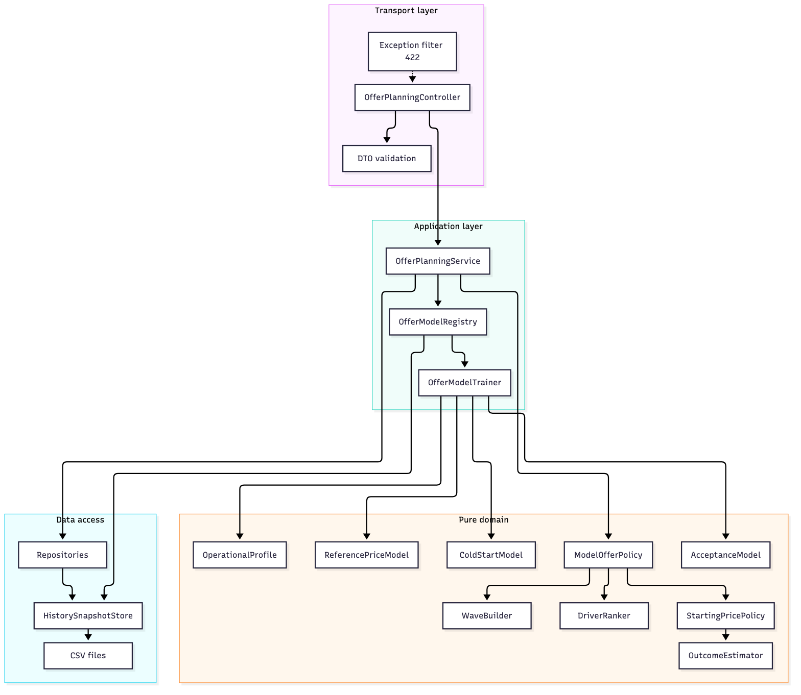
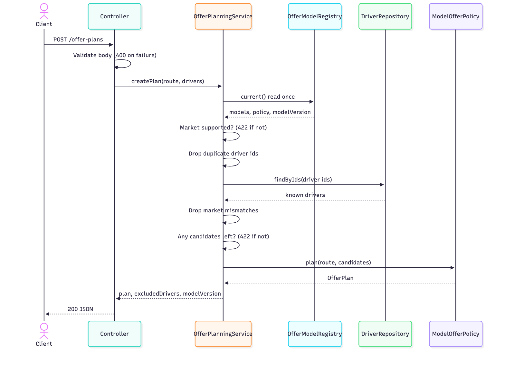
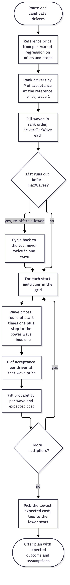
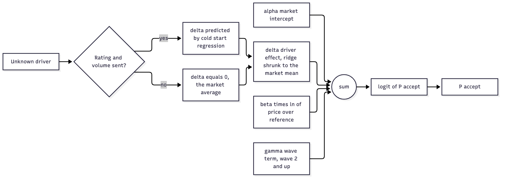
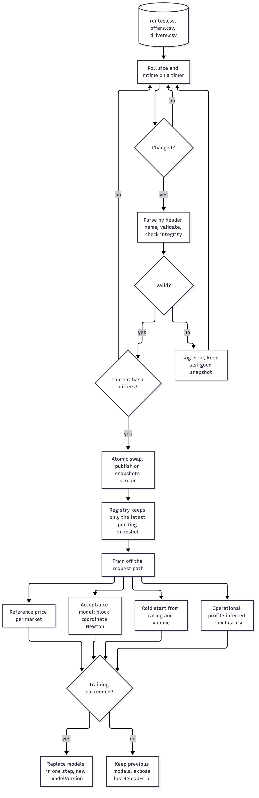
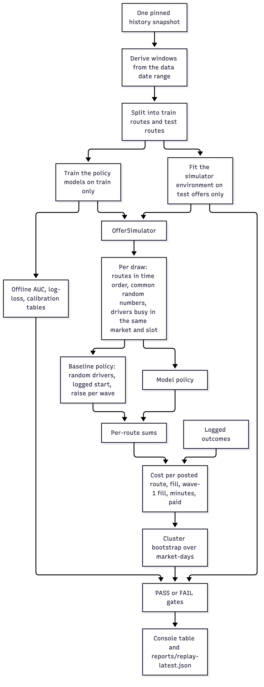
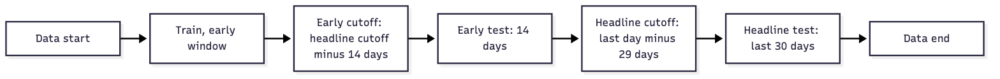

# System design and logic

This document explains how the route offer ranking service is built and why. The diagrams are images so they display in any Markdown reader. Their Mermaid sources are in [`docs/diagrams/`](diagrams/), and `npm run docs:diagrams` regenerates the images.

## 1. The problem

A new route is offered to drivers in waves, and the price rises each wave. Start low and the route sits while the price climbs. Start high and Vamo overpays. The service answers three questions for a new route: **which drivers, in what order, at what starting price**. The replay script checks the answer on held-out routes against the current baseline (random drivers, start low, raise about 8% per wave).

## 2. What the data says

These findings drive the design. They come from analysis of the provided CSVs (2,000 routes, 18,712 offers, 180 drivers, 5 markets).

| Finding | Design consequence |
| --- | --- |
| Driver acceptance is persistent: the correlation between two halves of the history is about 0.85. | Rank drivers by a learned per-driver effect. This is the main lever. |
| The baseline order is random. | Any informed order beats it. |
| The wave 1 price is almost linear in miles and stops (R-squared about 0.9 per market). | A per-market regression gives a reference price, and acceptance is modeled against price relative to it. |
| Re-offers to the same driver accept more often (13.7%) than first offers (8.8%). | Allow re-offers, and model a wave effect. |
| On-time completion has no stable per-driver signal (correlation about -0.06). | Report on-time. Do not rank by it. |
| Time of day and weekday effects are small. | Leave them out. |
| 45% of holdout routes share a market and start time with another route. | The replay must not let one driver accept two routes in the same slot. |

## 3. Architecture



Layers, from the top:

- **Transport:** the controller validates the body with class-validator (400 on failure) and maps domain errors to 422 through an exception filter.
- **Application:** `OfferPlanningService` coordinates one request. `OfferModelRegistry` owns the trained models and `OfferModelTrainer` builds them.
- **Pure domain:** models and policies with no I/O. Plain classes, so the replay can retrain them on any slice of history.
- **Data access:** repositories read the current snapshot from `HistorySnapshotStore`, which is the only code that touches the CSV files.

Dependencies point toward the domain. The domain never imports Nest or the data layer.

## 4. One request



- The service reads the registry once, so a request sees one consistent model even if a retrain finishes mid-request.
- An unknown market, or a market without enough data, returns 422 with a reason.
- Duplicate driver IDs and drivers from another market are excluded and reported in `excludedDrivers`.
- Drivers with no history are still planned. They use the cold-start model if the caller sends `rating` and `routesCompleted90d`, otherwise the market average.

## 5. The policy



**Reference price.** For each market, ordinary least squares of `wave1_price` on miles and stops. This models the baseline's own starting rule, so "price relative to reference" has a stable meaning.

**Ranking.** Drivers are sorted by their probability of accepting at the reference price in wave 1. Price and wave are the same for every driver, so this equals sorting by the driver effect. Ties break by driver ID so results are deterministic.

**Waves.** Waves are filled in rank order, with the number of drivers per wave seen in the data. If the pool is smaller than the slots, the list cycles and the same drivers are offered again, never twice in one wave.

**Starting price.** For each candidate start between 0.70 and 1.40 times the reference (steps of 0.05), the wave prices are `round(start x (1 + step)^(wave - 1))`. For each, the service computes the chance the route fills in each wave and the expected cost:

```
expected cost = sum over waves of P(fill in wave k) x price_k
              + P(unfilled) x 2.0 x reference
              + 0.03 x reference x sum over waves of P(fill in wave k) x (k - 1)
```

It picks the cheapest start. The `2.0` and `0.03` are explicit assumptions, not Vamo's numbers: they set how much an unfilled route and each extra wave of waiting are worth. They are echoed in every response under `assumptions`.

## 6. The acceptance model



```
logit P(accept) = market intercept + driver effect + beta x ln(price / reference) + wave term
```

- **Driver effect** is shrunk toward the market average with a ridge penalty (lambda = 2), because most drivers have few offers and some have none accepted.
- **Training** is block-coordinate Newton: a dense step on the few global parameters, then an independent one-dimensional step per driver. Each pass is linear in the number of offers, so it scales with drivers. Training throws if it has not converged within 200 passes.
- **Cold start:** a regression of fitted driver effects on standardized rating and 90-day volume, used only for drivers with no history. It is disabled if fewer than 20 drivers have attributes.
- **Minimum data:** a market needs at least 200 offers and 5 acceptances, or it is reported unsupported.
- `no_response` counts as not accepted.

## 7. Data independence and reload

The CSVs are an input format, not a fixed dataset.



- Columns are matched by header name (case-insensitive). Order does not matter and extra columns are ignored.
- Markets, the number of waves, drivers per wave, wave interval and price step are inferred from the data (`OperationalProfile`), with config overrides and a fallback to defaults with a warning.
- Rows are validated, and the three files are checked against each other. A bad row fails the load by default, or is skipped and reported under policy `skip`.
- When files change, the store validates the new data and swaps it in one step. If the new files are invalid it keeps the last good snapshot and retries when they change again.
- Retraining runs off the request path. If several changes arrive during a retrain, only the newest is trained next. A failed retrain keeps the previous models.
- `modelVersion` is the data fingerprint plus the training time, so a response says which data produced it.

## 8. How the result is evaluated



The replay compares the model policy with the baseline on routes the models never saw.



- **Windows by rule:** the headline holdout is the last 30 days of the data. An earlier 14-day window is a second check. Both can be overridden from the command line.
- **Simulator:** an acceptance model fitted on the test window's offers only, so it is never the policy's own model. Both policies see the same random numbers, keyed by route, driver, draw and offer index.
- **Capacity:** within a draw, a driver who accepts a route is unavailable for other routes in the same market and start time.
- **Primary metric:** cost per posted route, which cannot be improved by leaving routes unfilled. The uncertainty comes from a bootstrap over whole market-days.
- **Gates:** the logged baseline must reconcile across files, the simulated baseline must match the logged one (fill, wave-1 fill, minutes), the model must beat a price-and-wave-only model offline, probabilities must be calibrated, few routes may sit at the price grid edge, and the cost difference interval must exclude zero.

## 9. Result and limits

On the provided data, the model policy costs 115.67 per posted route against 130.77 for the logged baseline, a difference of -14.33 (95% interval -15.01 to -13.65). The earlier window agrees in sign (-13.19). All gates pass except probability calibration, which fails in both windows, so the exact size of the gain is probably overstated. See [`WRITEUP.md`](WRITEUP.md) for the trade-offs and for what was tuned after seeing a first result.

Known limits:

- The simulator and the policy use the same model family, so pricing gains depend on that model being right outside the logged price range.
- Capacity is approximated by exact shared start times.
- Repeat offers to a driver are treated as independent.
- The model retrains on all history with no recency weighting.
- Everything is held in memory, which is fine for hundreds of thousands of offers and not for much more.
