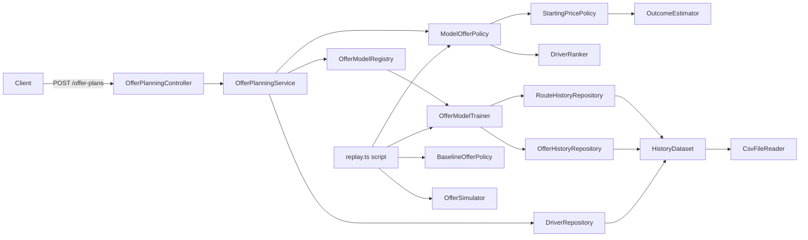

# Implementation plan: Route offer ranking service (Vamo take-home)

Status: revision 3 (2026-11-16). Decisions are confirmed, the independent review is applied, and the code is now data-independent. Ready for implementation. This is planning only — no code, branches, or commits were created.

Revision 3: the CSV files are an **input contract, not fixed data**. The same file formats may hold other data (other markets, dates, volumes, drivers, wave mechanics) and may change while the service runs.

- Nothing in the code may hardcode markets, dates, row counts, wave counts, or the price step.
- Every number quoted in section 2 describes the **current snapshot** of the provided files. Those numbers are reference values for this dataset only. They never appear as constants in the code, and tests don't assert them except in one clearly labeled snapshot check.

Revision 2 applies a 38-question plan review. Grok 4.7 High wrote the questions and Opus 5.5 answered them against the CSVs. Its main findings, all reflected below:

- The plan was over budget (235 minutes against a 180-minute cap).
- The model's price fit was under-specified.
- The replay ignored re-offers and drivers being shared across overlapping routes.
- The fold dates didn't reproduce.
- Driver rating and 90-day volume do predict acceptance.

## Confirmed decisions

- **Request shape (minimum, with cold-start fields):** `{ route: { routeId?, market, scheduledStart?, stopCount, totalMiles }, availableDrivers: [{ driverId, rating?, routesCompleted90d? }] }`.
  - `rating` and `routesCompleted90d` are optional and used **only for drivers with no history**. Known drivers are scored from their own offer history, which makes these fields redundant for them.
  - `scheduledStart` is optional, echoed back, and reserved for future time features.
  - Unknown extra fields are rejected.
- **Holdout split, derived from the data:**
  - Headline: `cutoff = startOfDay(max(scheduled_start)) − (holdoutDays − 1) days`, with `holdoutDays = 30` by default. The early robustness window ends at that cutoff and starts `earlyWindowDays = 14` days earlier.
  - Both values can be overridden on the command line (`--holdout-days`, `--early-days`, or an explicit `--cutoff`).
  - On the current snapshot this reproduces the confirmed cutoff of `2026-10-01` (638 routes) and an early cutoff of `2026-09-17`.
  - The replay refuses to run if the training or test slice is below a minimum size (defaults: 200 training routes, 50 test routes).
- **Data independence and changing files:**
  - Markets, wave mechanics (number of waves, drivers per wave, wave interval, price step), and evaluation windows are all derived from whatever history is loaded. Config can override them.
  - The service watches the data files. When they change, it reloads and retrains in the background and swaps in the new model in one step.
  - If the new files fail to load, it keeps serving the last good model. `modelVersion` includes a fingerprint of the file contents.
- **Cost settings:** `unfilledPenaltyMultiplier = 2.0` and `delayCostPerWaveMultiplier = 0.03`, both multiples of the reference price.
- **Primary metric (pre-registered):** realized cost per posted route = price paid if filled, plus `2.0 × reference` if unfilled, plus `0.03 × reference × (filledWave − 1)`. Lower is better. Any improvement claim must hold in both windows.

Source "ticket": [`README.md`](../README.md) plus the original requirements email from Scott (route distribution take-home). There is no Jira issue.

---

## 1. Ticket assessment

### Problem statement

Every posted route needs a driver, and offers go out in waves. Starting too low means the route sits while the price rises; starting too high means overpaying. Build a small TypeScript/Node service that takes a new route and the drivers available in its market, and returns **which drivers to offer it to, in what order, and at what starting price**. Also build a replay script that compares this approach on held-out routes against the baseline in the data (start low, raise about 8% each wave).

### Expected behavior

- One HTTP endpoint. It takes a route and the available drivers and returns an ordered offer plan: the waves, the drivers in each wave, and the price for each wave.
- A replay script that runs the approach and the baseline on held-out routes and prints comparable metrics: cost, price, speed, and fill rate.
- A README on how to run both, and a one-page write-up covering the approach, trade-offs, production metrics, signal vs. noise, and next week.

### Acceptance criteria (derived from the email)

1. A NestJS (TypeScript/Node) service exposing exactly one business endpoint.
2. The response contains the ordered driver list, the wave grouping, and the starting price, plus the price path it implies.
3. The replay script trains on one slice and evaluates on a **held-out** slice, comparing against the logged baseline.
4. The README explains setup, running the service, and running the replay.
5. There is a one-page write-up in the repo.
6. There is a clear separation between controller (transport), service (business logic), and repositories (data access).
7. Total effort is 3 hours or less. When the time runs out, stop and document next steps.

**Must-ship order** (protects deliverables over polish):

1. The endpoint, with a happy-path test.
2. The headline replay table vs. the baseline.
3. The README.
4. The write-up.
5. Everything else, in the extras order in section 5.

### Missing or contradictory requirements

| Gap | Decision in this plan |
| --- | --- |
| The input shape for "drivers available in that market" is unspecified. | `availableDrivers: [{ driverId, rating?, routesCompleted90d? }]`. Known IDs are scored from history. Unknown IDs use a cold-start estimate from `rating`/`routesCompleted90d` when given, otherwise the market average. Drivers from another market are excluded and reported. |
| "Start low" is not defined numerically. | The baseline start is the logged `wave1_price`, compounding ×1.08 on the rounded previous price. The logged steps run slightly below that (mean −$0.45), so the simulated baseline is about 0.4% more generous than the log. The "logged baseline" row uses actual logged prices. |
| The number of waves, drivers per wave, and wave interval are not specified. | Mirror the log: up to **4 waves**, **4 drivers per wave**, **30 minutes per wave**. All configurable. |
| Driver availability per route is not in the data. | All drivers in the route's market are available. The replay is **capacity-aware**: a driver who accepts one route is unavailable for other routes in the same market and start time. |
| The data includes re-offers to the same driver. | 1,881 route–driver pairs got offers in more than one wave, and re-offers accept at 13.7% vs. 8.8% for first offers. Both policies may re-offer (see step 5), and the simulator draws a fresh decision per re-offer. |
| The cost of an unfilled route and the value of speed are not given. | Explicit config settings with documented defaults (2.0 and 0.03). |
| The files may hold other data or change at runtime (user requirement). | The CSVs are read by **header name**: column order doesn't matter and extra columns are ignored. Rows are validated, cross-file references are checked, and a data-quality report is produced. Markets and wave mechanics are derived from the data; evaluation windows follow the rule above. Changes are detected by file stat plus a content hash and reloaded atomically, and a failed reload keeps the last good model. |
| Some markets may have too little data. | There are minimum-data thresholds per market (defaults: at least 20 routes for the reference price, at least 200 offers and at least 5 acceptances for the acceptance model). A market below them is unsupported, and the endpoint returns 422 with the reason. |
| There are no counterfactual responses for offers that were never made. | The replay uses a simulator fitted on holdout data only. It is checked against logged holdout outcomes (fill, wave-1 fill, minutes), plus a simulator-free offline check (AUC/log-loss and calibration). The write-up states that pricing gains depend on the model. |

### Is the change appropriate for the architecture?

Yes. The repository has only data and AI guidance: one `Initial commit` on `main` and no `package.json`. Ladder level 1 already gives the required controller/service/repository split. Level 1 means one feature module per capability, each with its controller, service, and repositories (`ai/skills/nestjs-architecture-principles/references/architecture-ladder.md`).

This plan uses one `history` module (data access shared by the service and the replay) and one `offer-planning` module. Inside `offer-planning`, a `domain/` folder holds pure business logic with no Nest imports. That follows architecture rule 4, "point dependencies toward policy". No database, queue, CQRS, or microservice is justified; the CSVs are loaded into memory once at boot, behind repositories.

---

## 2. Current behavior

### Verified facts about the current data snapshot (read-only analysis of `vamo-takehome-data/`; reproduced independently by the reviewer)

These facts justify the modeling choices. The code must not depend on any of these specific values: markets, counts, dates, wave counts, step ratios, and coefficients are all derived at load time.

Repository state:

- Branch `main`, single commit `15a5676 Initial commit`, remote `git@github.com:normandanielmq/vamo-takehome.git`.
- No source code yet. `vamo-takehome-data/` is untracked and must be committed. Node `v22.18.0` and npm `10.9.3` are installed locally.

Data shapes:

- `routes.csv` (2,000 rows): `route_id, market, scheduled_start, weekday, stop_count, total_miles, wave1_price, final_wave, final_price, accepted, accepted_driver_id, minutes_to_accept, completed_on_time`.
  - `accepted` and `completed_on_time` are `True`/`False`.
  - Unfilled routes have empty `accepted_driver_id`, `minutes_to_accept`, and `completed_on_time`.
- `offers.csv` (18,712 rows): `route_id, wave, offer_price, driver_id, response`. Responses: `accepted` 1,736, `declined` 11,338, `no_response` 5,638.
- `drivers.csv` (180 rows): `driver_id, market, rating, routes_completed_90d`. The five markets have 32–39 drivers each. No offer ever crosses markets.

Operational mechanics:

- **Waves:** at most 4. `final_wave` counts are 317 / 547 / 535 / 601. Fill rate is 86.8% (264 routes unfilled).
- **Wave clock:** 30 minutes. `minutes_to_accept` falls in 2–30 / 32–60 / 62–90 / 92–120 for waves 1–4.
- **Drivers per wave:** most waves offer 4 drivers (3,979 of 5,420 route-waves). A route sees up to 16 offers, with a median of 8 unique drivers.
- **Re-offers:** 1,881 route–driver pairs were offered in more than one wave (1,779 twice, 100 three times, 2 four times), never twice in the same wave. Re-offer acceptance is 13.7% vs. 8.8% for first offers. The share of offers that are re-offers is 0 / 11 / 22 / 31% for waves 1–4.
- **Price steps:** the wave-1 offer price equals `wave1_price`. Step ratios for prices ≥ $50 are 1.071–1.088; the wider 1.055–1.091 range comes from rounding small prices.
- **Overlapping routes:** 288 of the 638 holdout routes (45%) share a market and start time with another route.
- **Date range and payouts:** routes run from 2026-08-01 to 2026-10-30. Accepted routes paid on average 1.12× their `wave1_price`.

Signals (these drive the design):

1. **The reference price is predictable.** Each market gets an OLS fit, `wave1_price ~ 1 + total_miles + stop_count`.
   - Per-market R² is 0.90–0.91; a single global fit gets 0.82.
   - Miles and stops are highly correlated (0.88–0.90), so individual slopes shift between fits even when predictions don't.
   - **Interpretation:** the model is fitted to the incumbent's wave-1 price, so it reproduces the baseline's own starting rule, not a market value. The ratio \(\ln(\text{price}/\text{reference})\) measures distance from where the baseline would have started.
2. **Acceptance rises with price relative to the reference.** Offer-level acceptance goes from about 2% at 0.8× reference to about 12–16% at 1.2–1.45×.
3. **Acceptance rises with wave even at the same price ratio.** At a ratio of about 1.10:
   - All offers: 5.1 / 10.6 / 14.1 / 16.4% for waves 1–4.
   - First-time offers only: 5.1 / 11.3 / 15.2 / 17.5%, so re-offers don't explain the effect.
   - The mix of drivers offered is flat across waves.
   - Price support overlaps across all waves only between about 1.05× and 1.30×.
   - The model must include a wave term.
4. **Driver identity is the strongest signal.**
   - Per-driver acceptance ranges from 0% to 40%.
   - Split by date at the median (2026-09-14), the same drivers' acceptance correlates at 0.87 between halves. On a split that never touches the holdout (train vs. holdout), the correlation is still **0.847**.
   - At wave 1, the lowest propensity bucket accepts 0.6% of offers vs. 15.1% for the top bucket.
5. **The baseline does not rank drivers.** Offered drivers' historical propensity, rating, and 90-day volume are flat across waves.
   - Rating and volume *do* predict acceptance on their own, controlling for market, price, and wave (standardized rating +0.121, z = 4.3; volume +0.210, z = 7.9).
   - They act as proxies for each driver's own acceptance rate. That makes them redundant for known drivers but useful for cold start.
6. **No detectable on-time signal per driver.**
   - Per-driver on-time correlates at −0.06 between halves, but this test is weak: 110 drivers, median 5 accepted routes each.
   - On-time is about 76% across waves and lower at 14:00 (0.687).
   - On-time is reported, not ranked on.
7. **Time of day and weekday barely move acceptance** (8.5–9.9% by hour, 8.7–9.9% by weekday), so they are excluded.
8. **`no_response` is treated as not accepted.**
   - No-response barely moves with price (0.34 → 0.27) or wave (0.32 → 0.28), and the per-driver no-response rate is only weakly stable (0.29; 0.19 on the train vs. holdout split).
   - Ranking by overall P(accept) is unaffected by this choice. A two-stage seen-then-accept model is next-week work.

### Evaluation windows (derived by rule; values shown are for the current snapshot)

The rule is `headlineCutoff = startOfDay(maxScheduledStart) − 29 days` and `earlyCutoff = headlineCutoff − 14 days`. Each window trains on all routes strictly before its cutoff. The headline window tests from its cutoff to the end of the data; the early window tests from the early cutoff up to the headline cutoff.

| Window | Train (strictly before cutoff) | Test window | Train routes | Test routes | Logged fill | Logged mean paid (filled routes) |
| --- | --- | --- | --- | --- | --- | --- |
| Early (robustness) | before 2026-09-17 | 2026-09-17 to before 2026-10-01 (14 days) | 1,041 | 321 | 0.866 | 116.22 |
| Headline | before 2026-10-01 | 2026-10-01 to end of data (30 days) | 1,362 | 638 | 0.876 | 114.23 |

Logged baseline outcomes (calibration targets):

| Slice | Routes | Fill rate | Filled in wave 1 | Mean price paid | Paid / wave1 | Mean minutes to accept | On-time given filled |
| --- | --- | --- | --- | --- | --- | --- | --- |
| Train (before Oct 1) | 1,362 | 0.864 | 0.171 | 112.92 | 1.120 | 60.7 | 0.764 |
| Holdout (Oct 1 on) | 638 | 0.876 | 0.132 | 114.23 | 1.124 | 62.5 | 0.751 |

Prophet (`../prophet`, Meta's time-series forecasting library) was evaluated and rejected. This problem is per-offer choice and pricing, not series forecasting, and time effects are negligible (signal 7). No code was reused.

### End-to-end code path (to be built — nothing exists today)

Layer ownership:

- **Controller** (`OfferPlanningController`): HTTP, DTO validation, and response mapping only.
- **Application service** (`OfferPlanningService`): resolves drivers through the repository, deduplicates and filters them by market, calls the policy, and maps the result to a response view.
- **Domain** (plain TypeScript, no Nest imports): `ReferencePriceModel`, `AcceptanceModel`, `ColdStartModel`, `DriverRanker`, `OutcomeEstimator`, `StartingPricePolicy`, and the `OfferPolicy` implementations.
- **Repositories** (`DriverRepository`, `RouteHistoryRepository`, `OfferHistoryRepository`): use-case queries over the **current** `HistorySnapshot`, read from `HistorySnapshotStore` on each call. They are the only code that knows CSV column names.
- **Snapshot store** (`HistorySnapshotStore`, infrastructure): owns loading, validation, change detection, and the atomic swap of the immutable `HistorySnapshot`. `OfferModelRegistry` subscribes to new snapshots and retrains in the background.

### Root-cause hypothesis (why the baseline is inefficient)

1. **Driver order is random**, so early waves are mostly spent on drivers who almost never accept (signals 4–5). Ranking alone should raise wave-1 fill without raising the price.
2. **The starting price ignores who is being offered.** When the strongest drivers go first, a slightly lower start can still fill quickly.
   - Review simulation with a converged fit and 2.0/0.03 settings: the chosen starts were 0.85–1.0× reference, at or below the baseline's ≈1.0×.
   - Higher unfilled penalties move the start up (0.90–1.05 at 3.0, 1.00–1.15 at 5.0).
   - This is model-dependent and must be confirmed by the replay.

### Remaining unknowns

- True driver availability. The capacity-aware simulation bounds the biggest bias, but real availability data is needed.
- The business cost of an unfilled route and of each 30-minute delay. These are exposed as config.
- Whether a re-offer's acceptance is independent of the earlier decline. The simulator assumes a fresh draw, which matches the logged re-offer rate being similar to first-offer rates at later waves.
- Pricing outside the logged price range. Starting prices below 0.85× reference have almost no wave-1 data, so the search grid is floored at 0.85.

---

## 3. Subagent topology

**No subagents are needed for implementation.** All evidence is local: three CSVs and an empty repo. There are no external logs, vendors, or databases. Plan review used two read-only subagents (Grok 4.7 High for questions, Opus 5.5 for evaluation), and their key claims were spot-checked: the 235-minute total, 288/638 overlapping routes, and 13.7% re-offer acceptance.

---

## 4. Evidence requests

- **External logs/traces:** none.
- **SQL:** none — there is no database.
- **Runtime evidence:** all acceptance gates live in **section 6 (authoritative)**. If any gate fails, the replay result is reported as inconclusive rather than as an improvement.

---

## 5. Step-by-step implementation plan

Time budget: **180 minutes** across steps 1–8, with target times in brackets. The revision 3 data-independence work goes into step 2 (+10 minutes) and step 6 (+5). To pay for it, step 5 and step 7 each lose 5 minutes and step 8 loses 10. Step 9 extras run only with time left over, in the order listed. When time runs out, stop and list the remaining extras as next steps in the write-up.

**Data-independence rules for every step:**

- No literal market codes, dates, row counts, or wave/step constants in `src/`. These may appear only in fixtures, tests labeled as snapshot checks, and docs.
- Unit tests use small fixture CSVs, including deliberately different data: a new market code, five waves, a different price step, and reordered or extra columns.
- One opt-in snapshot test (`npm run test:snapshot`) asserts the current files' counts and logged metrics. It documents the provided dataset and is not part of the default `npm test`.

### Step 1 — Scaffold the NestJS project [15 min]

- **Objective:** a runnable, type-checked Nest app with test tooling.
- **Files:**
  - `package.json`, with `engines.node: ">=20"` and a committed `package-lock.json`.
  - `tsconfig.json`, `tsconfig.build.json`, `nest-cli.json`, and Jest config.
  - `src/main.ts` and `src/app.module.ts`.
- **Change:**
  - **Dependencies:** `@nestjs/common`, `@nestjs/core`, `@nestjs/platform-express`, `@nestjs/config`, `reflect-metadata`, `rxjs`, `class-validator`, `class-transformer`, `csv-parse`.
  - **Dev dependencies:** `typescript`, `@nestjs/cli`, `@nestjs/testing`, `jest`, `ts-jest`, `@types/jest`, `supertest`, `@types/supertest`, `@types/node`. Check versions with `npm view`.
  - **tsconfig:** `strict`, `experimentalDecorators`, `emitDecoratorMetadata`, `target: ES2022`, `module: commonjs`, `outDir: dist`.
  - **Scripts:** `build`, `start`, `start:dev`, `typecheck` (`tsc --noEmit`), `test`, `test:e2e`, and `replay` (`npm run build && node dist/replay/replay.js`). Run the replay from compiled JS, because esbuild (`tsx`) doesn't emit decorator metadata.
  - **`main.ts`:** global `ValidationPipe({ whitelist: true, forbidNonWhitelisted: true, transform: true })`, with `PORT` from env (default 3000).
  - **`src/config/app.config.ts`:** validated environment settings.
    - `DATA_DIR` (default `vamo-takehome-data`).
    - `ROUTES_FILE`, `OFFERS_FILE`, `DRIVERS_FILE` (defaults `routes.csv`, `offers.csv`, `drivers.csv`, resolved against `DATA_DIR` unless absolute).
    - `DATA_RELOAD_INTERVAL_MS` (default 5000; `0` disables reloading).
    - `DATA_INVALID_ROW_POLICY` (`fail` | `skip`, default `fail`).
- **Verification:** `npm run typecheck` and `npm run build` pass, and `npm start` boots.
- **Done when:** a clean install builds and boots.

### Step 2 — History data module, schema contract, and change-aware snapshot store [30 min]

- **Objective:** typed, read-only data access that works with any data in this format, validates it, and picks up file changes safely. All CSV knowledge lives here.
- **Files:**
  - `src/history/history.types.ts`:
    - `Market` is a branded `string` (`type Market = string & { readonly __brand: 'Market' }`), not a union of codes. The available markets come from the data.
    - `OfferResponse` is `'accepted' | 'declined' | 'no_response'`.
    - `HistoricalRoute`, `HistoricalOffer`, and `Driver`. `HistoricalRoute` has `scheduledStart: Date` and nullable `acceptedDriverId`, `minutesToAccept`, and `completedOnTime`.
  - `src/history/csv-schema.ts`: a declarative schema per file, listing each required column with its parser (`string`, `int`, `number`, `bool`, `isoDate`, `enum`, plus whether it's nullable).
    - Columns are matched **by header name, case-insensitively and with surrounding whitespace trimmed**, so order doesn't matter. Unknown columns are ignored. A missing required column fails with the file name and the missing column names.
    - The `weekday` column is optional and never used, because it can be derived from `scheduled_start`.
    - Parsers are tolerant:
      - Booleans accept `True`/`False`/`true`/`false`/`1`/`0`/empty (empty means null where nullable).
      - Numbers accept surrounding whitespace.
      - Dates accept ISO 8601 with or without an offset. A timestamp without an offset is read as UTC, consistently across load and replay.
      - `response` accepts any letter case.
  - `src/history/csv-file.reader.ts`: `CsvFileReader.read(path, schema, policy)` using `csv-parse/sync` with `columns: true`, `bom: true`, `skip_empty_lines: true`, and `trim: true`.
    - It collects row errors with file, line, column, and value.
    - Under policy `fail` (the default) it throws one aggregated error listing up to 20 problems plus the total count.
    - Under policy `skip` it drops bad rows and records them in the data-quality report.
  - `src/history/history-snapshot.ts`: the immutable `HistorySnapshot { routes; offers; drivers; markets; fingerprint; loadedAt; quality: DataQualityReport }`. `loadHistorySnapshot(paths, policy)` loads all three files, then runs the integrity checks:
    - **Duplicate primary keys** (`route_id`, `driver_id`, and the triple of route, wave, and driver): an error.
    - **Offers on unknown routes:** dropped and counted.
    - **Offers to drivers missing from `drivers.csv`:** kept. The driver's market is taken from the route, and the driver has no attributes.
    - **Offers whose driver market differs from the route market:** kept and counted as a warning.
    - **`accepted_driver_id` with no matching accepted offer:** counted as a warning.
    - `markets` is the set of distinct route markets.
    - `fingerprint` is a SHA-256 hash of the three files' bytes, shortened to 12 hex characters.
  - `src/history/history-snapshot.store.ts`: the `HistorySnapshotStore` provider.
    - Loads once at module init and fails at startup if the files are invalid.
    - When `DATA_RELOAD_INTERVAL_MS > 0`, it checks each file's `mtimeMs` and size on a timer. Only when something changed does it re-read the files and compare content hashes, so a rewrite with identical content doesn't trigger a retrain.
    - When the content changed, it loads a new snapshot and swaps the reference in one step. Requests already running keep using the snapshot they started with.
    - A file caught mid-write fails parsing. The store logs the error, keeps the last good snapshot, and retries on the next tick.
    - It exposes `current(): HistorySnapshot` and an RxJS `Subject` of changes (`snapshots$`; `rxjs` is already a dependency).
  - Repositories read `store.current()` on every call:
    - `DriverRepository`: `findByIds(ids)`, `findByMarket(market)`, and `findAll()`.
    - `RouteHistoryRepository`: `findScheduledBefore(cutoff)`, `findScheduledBetween(from, toExclusive?)`, `findAll()`, `scheduledRange()`, and `markets()`.
    - `OfferHistoryRepository`: `findByRouteIds(ids)` and `findAll()`.
  - `src/history/history.module.ts`: provides the store and exports the store plus the three repositories.
- **Why here:** repositories are the data-access boundary (architecture rule 7: methods name use-case queries). The store is the single owner of loading and swapping data, so no other layer reads files or caches stale copies.
- **Verification:** `test/fixtures/` holds several small datasets:
  - `baseline/`: 3–5 rows per file.
  - `variant/`: reordered and extra columns, lowercase booleans, a new market `SEA`, 5 waves, and timestamps with an offset.
  - `broken/`: a missing column, a bad number, a duplicate `route_id`, and an offer on an unknown route.

  Specs:
  - `csv-schema.spec.ts` checks that `variant/` parses identically to an equivalent canonical file, and that a missing column names the column.
  - `history-snapshot.spec.ts` covers the integrity counts, the `fail` vs `skip` policies, and that the fingerprint changes when content changes and stays the same for an identical rewrite.
  - `history-snapshot.store.spec.ts` uses a temp directory and fake timers:
    - Rewriting a file produces a new snapshot and fingerprint.
    - Writing an invalid file keeps the old snapshot and logs an error.
    - Restoring a valid file recovers on the next check.
  - The opt-in `snapshot.spec.ts` (`npm run test:snapshot`) asserts the provided dataset's counts.
- **Done when:** the specs pass. Deleting the real data and pointing `DATA_DIR` at `test/fixtures/variant` still boots the service.

### Step 3 — Reference price model [10 min]

- **Objective:** a per-market reference price, documented as a model of the baseline's starting price (signal 1).
- **Files:** `src/offer-planning/domain/linear-regression.ts` and `src/offer-planning/domain/reference-price.model.ts`.
- **Change:**
  - `fitLeastSquares(rows, targets)` solves the normal equations by Gaussian elimination with partial pivoting.
  - `ReferencePriceModel.fit(routes)` fits each market separately.
  - `priceFor({ market, totalMiles, stopCount })` throws `UnsupportedMarketError` (with a reason) for a market below `minRoutesForReferencePrice` (default 20) or one whose fit is singular. For example, every route might have the same stop count; the error says so.
  - Markets are whatever appears in the training routes. There is no market list in code.
- **Verification:**
  - A synthetic test with noiseless data recovers the known coefficients, for an arbitrary market code.
  - A market with too few routes, or with constant stop counts, throws `UnsupportedMarketError` with the reason.
  - **Snapshot check, opt-in only:** fit on the derived train slice of the provided data, then price an NYC route of 50 miles and 10 stops within ±3% of a pinned value. The reviewer's fit implies about 83.8; recompute and pin it.
- **Done when:** the spec passes.

### Step 4 — Acceptance model and cold start [25 min]

- **Objective:** a converged estimate of \(P(\text{accept} \mid \text{driver}, \text{price}, \text{wave})\), plus a cold-start estimate for unknown drivers.
- **Files:** `src/offer-planning/domain/acceptance.model.ts`, `src/offer-planning/domain/cold-start.model.ts`, and `src/offer-planning/domain/linear-algebra.ts` (a small dense solver).
- **Change:**
  - **`AcceptanceModel`** is a logistic regression: \(\text{logit}(p) = \alpha_m + \delta_d + \beta \ln(\text{price}/\text{reference}) + \gamma_{\text{wave}}\).
    - Parameters:
      - One intercept \(\alpha_m\) per market present in the data.
      - One deviation \(\delta_d\) per driver.
      - \(\beta\) for price.
      - One wave term \(\gamma_k\) for each wave \(k\) from 2 up to the **highest wave in the training data**, relative to wave 1.
      - The parameter count depends on the data; it is about 189 on the current snapshot.
    - **Training uses block-coordinate Newton**, so it scales with the number of drivers instead of cubing it:
      1. A dense Newton step on the global parameters (\(\alpha\), \(\beta\), \(\gamma\); a few dozen at most) with the drivers fixed.
      2. An independent one-dimensional Newton step for each driver's \(\delta_d\) with the global parameters fixed.
      3. Repeat. Each pass is \(O(\text{offers})\).
    - There is a ridge penalty \(\lambda = 5\) on \(\delta_d\) (configurable within 2–10) and a very small one (\(10^{-4}\)) on \(\alpha\) and \(\gamma\). The small one keeps the fit finite for a market or wave with no acceptances.
    - Training stops when the largest parameter change is below \(10^{-6}\), or after 50 passes. If it hasn't converged by then, it throws `ModelTrainingError`.
    - **Minimum data:** a market needs at least 200 offers and at least 5 acceptances (configurable). Markets below that are left out of the model and reported as unsupported.
    - The penalty matters: 46–54 drivers have zero acceptances, and their deviations would run to −∞ without it.
    - `no_response` counts as not accepted.
    - The review measured that a rough gradient-descent fit (β ≈ 1.7) pushes every route to the bottom of the price grid, while a converged fit (β ≈ 3.3–3.6) gives interior starts. This is why the fitting method is specified.
  - **`ColdStartModel`:** an OLS regression of the fitted driver deviations \(\delta_d\) on standardized `rating` and `routesCompleted90d` (from `drivers.csv`), with no intercept, using the same `fitLeastSquares`.
    - Standardization uses the training data's means and standard deviations.
    - If fewer than 20 drivers have attributes, or the fit is singular, the model is disabled and every unknown driver falls back to the market average (`coldStart: 'market'`).
    - An unknown driver with both attributes gets \(\delta = \) the predicted deviation.
    - An unknown driver without them gets \(\delta = 0\), meaning the market average.
    - Known drivers always use their own fitted \(\delta_d\); attributes sent in the request are ignored for them.
  - `probability({ driverId, market, price, referencePrice, wave, attributes? })` returns `{ p, coldStart: 'none' | 'attributes' | 'market' }`.
- **Why here:** these are the policy's beliefs. As plain classes, the replay can retrain them on any slice.
- **Verification:** `acceptance.model.spec.ts`, on data **generated with known parameters** (any market codes, 5 waves), checks that:
  - Training converges and recovers \(\beta\) and the wave terms within tolerance.
  - Probability strictly increases with price.
  - The stronger driver gets the larger \(\delta\).
  - An unknown driver without attributes equals the market average.
  - A market with zero acceptances is reported unsupported rather than diverging.
  - Training on 50,000 synthetic offers with 2,000 drivers finishes in under 5 s, which proves it scales past the current 180 drivers.
  - **Opt-in snapshot checks:** on the provided data, \(\beta \in [1, 6]\), wave terms rise with wave, and the cold-start rating and volume coefficients are positive (signal 5).
- **Done when:** the specs pass.

### Step 5 — Ranker, wave plan, outcome estimator, and starting-price policy [25 min]

- **Objective:** turn the model's estimates into an ordered plan with a starting price.
- **Files:**
  - `src/offer-planning/domain/operational-profile.ts`: `OperationalProfile.infer(routes, offers)` derives the wave mechanics from history instead of hardcoding them.
    - `maxWaves`: the largest `wave` in the offers.
    - `driversPerWave`: the most common number of offers per route-wave.
    - `waveIntervalMinutes`: inferred from the gaps between per-wave `minutes_to_accept` bands, defined as the median, across waves \(k\), of \(\min_{k+1} - \min_k\).
    - `priceStep`: the median of `offer_price[k+1] / offer_price[k] − 1` over route-waves with price at least $50.
    - Each value can be overridden in config. If inference fails (too few rows, inconsistent bands), it falls back to the config default (4, 4, 30, 0.08) and records a warning. On the current snapshot it infers 4 / 4 / 30 / ≈0.077–0.08.
  - `src/offer-planning/domain/offer-planning.config.ts`, `OfferPlanningConfig`:
    - Optional overrides for the four `OperationalProfile` values.
    - `startMultipliers: 0.85..1.40 step 0.05`.
    - `unfilledPenaltyMultiplier: 2.0`, `delayCostPerWaveMultiplier: 0.03`.
    - `allowReoffer: true`.
    - Everything downstream reads wave mechanics from the effective profile, never from literals.
  - `src/offer-planning/domain/offer-plan.ts` defines:
    - `OfferPlan { referencePrice; startingPrice; startMultiplier; waves: OfferWave[]; expected: { fillProbability; fillByWave: number[]; expectedPricePaid; expectedMinutesToAccept; expectedCost }; assumptions: { unfilledPenaltyMultiplier; delayCostPerWaveMultiplier; priceStep } }`.
    - `OfferWave { wave; price; offerAtMinute; drivers: RankedDriver[] }`. Every driver in a wave gets the offer at the same time; rank inside a wave is informational only.
    - `RankedDriver { driverId; rank; acceptProbability; coldStart; isReoffer }`.
  - `src/offer-planning/domain/driver-ranker.ts`: sorts by P(accept at reference price, wave 1), descending, with `driverId` as the tie-break. This is the same as sorting by \(\delta_d\), because price and wave don't vary across drivers. There is no on-time term (signal 6).
  - `src/offer-planning/domain/wave-builder.ts`: fills waves from the ranked list in order, `driversPerWave` per wave.
    - If the list runs out before `maxWaves × driversPerWave` slots are filled and `allowReoffer` is on, it cycles back to the top of the list. A driver is never offered twice in the same wave.
    - Cycling matters for small pools.
  - `src/offer-planning/domain/outcome-estimator.ts`: for each wave \(k\), uses each driver's wave-\(k\) price to compute
    - \(P_k = \prod_{j<k}\prod_{i \in j}(1-p_{ij}) \cdot \bigl(1-\prod_{i \in k}(1-p_{ik})\bigr)\);
    - expected cost \(= \sum_k P_k \cdot \text{price}_k + P(\text{unfilled}) \cdot u \cdot \text{reference} + d \cdot \text{reference} \cdot \sum_k P_k (k-1)\), where \(u\) and \(d\) are the configured cost multipliers;
    - expected minutes from the wave midpoint, \((k-1) \cdot \text{interval} + \text{interval}/2\).
  - **Waves the model never saw:** if the profile allows more waves than the trained model has wave terms (for example config raised `maxWaves`), later waves reuse the last trained wave term. The plan reports this in `assumptions.extrapolatedWaves`.
  - `src/offer-planning/domain/starting-price.policy.ts`: for each multiplier, the wave prices are `Math.round(start × (1 + priceStep)^(k-1))`, rounded per wave. It picks the lowest expected cost; ties go to the lower start.
  - `src/offer-planning/domain/offer-policy.ts`: `interface OfferPolicy { plan(input: PlanningInput): OfferPlan }`.
  - `src/offer-planning/domain/model-offer.policy.ts` combines the ranker, wave builder, and pricer.
  - `src/offer-planning/domain/baseline-offer.policy.ts` takes its starting price (the logged `wave1Price`) in its own constructor, so the shared route type doesn't carry baseline-only fields.
    - It draws a uniform random sample of `driversPerWave` distinct drivers per wave from the pool, with an injected seeded random number generator.
    - Drivers may repeat across waves but not within a wave. This reproduces the logged re-offer pattern.
    - Each wave's price is `Math.round(previousPrice × (1 + priceStep))`, using the profile's inferred step. The email's "about 8%" is what this step infers to on the current data.
- **Why here:** the Strategy pattern is justified because the replay uses two genuinely interchangeable algorithms (OOP skill pattern table). Pure domain code is cheap to unit-test.
- **Verification:**
  - `driver-ranker.spec.ts` uses a **stub acceptance model with known probabilities** and asserts the exact order and tie-break, so an arbitrary ranking would fail.
  - `outcome-estimator.spec.ts` matches a hand-computed two-wave example to \(10^{-9}\).
  - `starting-price.policy.spec.ts` checks that raising `unfilledPenaltyMultiplier` never lowers the chosen start, and that zero drivers throws `NoEligibleDriversError`.
  - `wave-builder.spec.ts` checks that a 3-driver pool with `allowReoffer` gives `maxWaves` waves with no driver repeated inside a wave.
  - `operational-profile.spec.ts` checks:
    - A fixture with 5 waves of 3 drivers, 20-minute bands, and a 5% step infers exactly those values.
    - A fixture too small to infer from falls back to the defaults with a warning.
    - Overrides win over inferred values.
- **Done when:** the specs pass.

### Step 6 — Training registry, reload, and the endpoint [25 min]

- **Objective:** expose `POST /offer-plans`, always served from the newest successfully trained data.
- **Files:**
  - `src/offer-planning/offer-model.trainer.ts`: `OfferModelTrainer.train({ routes, offers, drivers }): TrainedOfferModels`. It is a pure function over arrays that builds the operational profile and the reference, acceptance, and cold-start models. It also returns the list of supported markets, with reasons for any unsupported ones.
  - `src/offer-planning/offer-model.registry.ts`: `@Injectable()` `OfferModelRegistry`.
    - Trains on the first snapshot in `onModuleInit`, and fails startup if training fails.
    - Subscribes to `HistorySnapshotStore.snapshots$`.
    - On a new snapshot it trains off the request path. If the trainer is mid-run, only the latest pending snapshot is kept. A successful run replaces the current models in one step.
    - On failure it logs, keeps the previous models, and exposes `lastReloadError`.
    - `current()` returns `{ models, modelVersion }`, where `modelVersion = "<snapshot fingerprint>-<trainedAt ISO>"`.
    - Each request reads `current()` once, so every request is consistent even while a swap happens.
  - `src/offer-planning/offer-planning.service.ts`: `createPlan(command)` runs these steps:
    1. Read `registry.current()` once.
    2. Check `route.market` against the model's supported markets. An unknown or unsupported market raises `UnsupportedMarketError` with a reason such as "not in data" or "below minimum data".
    3. Deduplicate driver IDs, keeping the first; the rest are excluded with reason `duplicate`.
    4. Look up known drivers.
    5. Exclude drivers whose known market differs from the route's (`market_mismatch`).
    6. Build the candidate list. Unknown IDs become cold-start candidates, carrying their optional attributes.
    7. Call `ModelOfferPolicy.plan`.
    8. Return the plan with `excludedDrivers`, `modelVersion`, and the effective `operationalProfile`.
  - `src/offer-planning/dto/create-offer-plan.dto.ts`:
    - `route`: `routeId?` (`@IsOptional @IsString`), `market` (`@IsString @IsNotEmpty @MaxLength(32)`; there is **no** fixed list, because supported markets come from the data and are checked in the service), `scheduledStart?` (`@IsOptional @IsISO8601`), `stopCount` (int ≥ 1), `totalMiles` (number > 0).
    - `availableDrivers`: `{ driverId: string; rating?: number 0–5; routesCompleted90d?: int ≥ 0 }[]`, with `@ArrayMinSize(1)`, `@ArrayMaxSize(200)`, `@ValidateNested`, and `@Type`.
    - Unknown extra fields are rejected by `forbidNonWhitelisted`.
  - `src/offer-planning/dto/offer-plan.response.ts`: mirrors `OfferPlan` and adds `routeId`, `market`, `scheduledStart`, `excludedDrivers`, and `modelVersion`. The README labels the probabilities and expected values as **model estimates (not calibrated guarantees)**, and the response echoes `assumptions`.
  - `src/offer-planning/offer-planning.controller.ts`: `@Controller('offer-plans')`, with `@Post() @HttpCode(200)`.
  - `src/offer-planning/offer-planning.module.ts`: imports `HistoryModule`.
  - **Errors:** `UnsupportedMarketError` and `NoEligibleDriversError` map to 422 through a small exception filter. A market that isn't in the data is a 422 (valid request, unsupported value), not a 400. Validation errors stay 400.
- **Why here:** the controller adapts the transport, the service coordinates, the domain decides, and repositories read. This follows architecture rule 4 (dependencies point toward policy) and ladder level 1.
- **Verification:** `test/offer-plans.e2e-spec.ts` with supertest. Each test copies a fixture dataset into a temp `DATA_DIR`; tests derive market and driver IDs from that fixture, with no literal production IDs.
  1. A valid route with 8 same-market drivers returns 200. The plan stays within the profile's `maxWaves` and `driversPerWave`, prices never decrease, ranks are unique, `startingPrice` is positive, and `assumptions` and `operationalProfile` are echoed.
  2. A table-driven set of 400s:
     - `market` missing.
     - `market: ""`.
     - An empty `availableDrivers`.
     - `stopCount: 0`.
     - `totalMiles: "abc"`.
     - An unknown extra field on a driver.
  3. A driver from another market lands in `excludedDrivers` as `market_mismatch`, and a duplicate ID lands there as `duplicate`.
  4. A market not in the data returns 422 with reason "not in data". A route whose drivers are all excluded also returns 422.
  5. An unknown driver without attributes returns 200 with `coldStart: 'market'`; the same driver with `rating` and `routesCompleted90d` gets `coldStart: 'attributes'`.
  6. Omitting `scheduledStart` and `routeId` returns 200.
  7. **Data from the `variant/` fixture** (new market, 5 waves, different step) returns a plan for the new market with up to 5 waves and the inferred step.
  8. **Files changing:**
     - Copy in a dataset that adds a new market and wait for the reload (`DATA_RELOAD_INTERVAL_MS=200` in tests). The new market becomes plannable and `modelVersion` changes.
     - Then write a corrupt file. Requests still succeed with the previous `modelVersion`.
- **Done when:** the e2e suite passes and a manual `curl` returns a plan.

### Step 7 — Core replay (headline split) [35 min]

- **Objective:** compare the model policy with the baseline on the headline holdout, while avoiding the biases the review identified. It must work on any dataset in the same format.
- **Files:**
  - `src/replay/replay.ts` is the entry point. It loads **one** `HistorySnapshot` with `loadHistorySnapshot` from the same env-configured paths, and the whole run uses that snapshot even if the files change mid-run. It builds the repositories over that snapshot (no `NestFactory`, because the trainer is a pure function).
    - Flags: `--draws` (default 200), `--seed` (default 42), `--window headline|early|both` (default `headline`), `--holdout-days` (default 30), `--early-days` (default 14), `--cutoff <ISO date>` (overrides the derived headline cutoff), and `--data-dir`.
    - The report records the snapshot fingerprint and data-quality summary.
  - `src/replay/evaluation-windows.ts`: `deriveWindows(scheduledRange, options)` applies the rule in section 2. It throws `InsufficientDataError` when a slice is below the minimum size (defaults: 200 training routes, 50 test routes).
    - `split(window)` returns the train routes and offers plus the test routes and offers.
    - Markets in the test window that the training window can't support are reported and left out of both policies' metrics. Both policies always see the same routes.
  - `src/replay/offer-simulator.ts` defines the environment:
    - It is an `AcceptanceModel` fitted with the same block-coordinate Newton trainer on **the window's test offers only**, so it is never the policy's own model.
    - **Common random numbers:** each draw is a uniform keyed by `(routeId, driverId, draw, offerIndexForThisDriverOnThisRoute)`. An offer is accepted when the uniform is below \(p(\text{price}, \text{wave})\). Both policies therefore see the same draw for a driver's n-th offer on a route, whatever its wave.
    - **Re-offers** get a fresh draw (offer index + 1).
    - **Capacity:** routes are processed in `scheduledStart` order, then by `routeId`. Within a draw, a driver who accepts a route is removed from the pools of the other routes in the same market and slot. The policy then re-plans those routes with the reduced pool.
    - The earliest wave with any acceptance wins. Minutes are `(k−1)×interval + uniform(1, interval)`, using the operational profile inferred from the training slice.
    - A "slot" is an exact (market, `scheduledStart`) match. This is data-agnostic, but if a dataset's start times aren't on a shared grid, few routes will overlap. The report prints the overlap rate so a reader can see when capacity effects are small.
    - The replay does **not** evaluate on-time. It reports the expected on-time count as fill × the holdout market on-time rate and says so.
  - `src/replay/replay-metrics.ts` computes these per policy:
    - **Primary:** mean realized cost per posted route (definition at the top).
    - **Secondary:**
      - Fill rate and wave-1 fill rate.
      - Mean minutes to accept.
      - Mean price paid / reference over filled routes.
      - Mean price paid over filled routes.
    - **Pricing diagnostics:** a histogram of chosen start multipliers and the share of routes at either end of the grid.
  - `src/replay/logged-baseline.ts`: computes the logged baseline's metrics **from the data at runtime**, never from constants. It also runs a cross-file consistency check:
    - Filled routes must equal routes with exactly one accepted offer.
    - Each filled route's `final_price` must equal its accepted offer's price.
    - `final_wave` must equal the accepted offer's wave.
    - Mismatches are counted; this replaces the old hardcoded "parse check".
  - `src/replay/paired-bootstrap.ts`: a **cluster bootstrap over market-days** (about 150 clusters on the current snapshot). It runs 1,000 resamples of the model-minus-baseline difference in the primary and secondary metrics and returns 95% percentile intervals. It excludes uncertainty in the fitted models, and says so.
  - `src/replay/offline-evaluation.ts` runs on the window's test offers at their logged price and wave:
    - AUC and log-loss of the policy's acceptance model vs. a model with price and wave only.
    - A calibration table by predicted-probability bucket (edges `[0, .02, .05, .1, .15, .2, .3, 1]`) with count, mean prediction, observed rate, gap, and 2 standard errors.
    - A calibration table by wave.
  - Output: a console table with rows for the logged baseline (logged prices), the simulated baseline, and the model policy. It also prints bootstrap intervals, offline metrics, the calibration tables, pricing diagnostics, and a gate report (section 6), and writes `reports/replay-latest.json`. `reports/` is added to `.gitignore`.
- **Why here:** the replay reuses the shipped trainer, policies, and repositories rather than copies.
- **Verification:**
  - `npm run replay -- --draws 20` finishes in under 60 s on the provided data.
  - Runs against `test/fixtures/variant` complete without code changes.
  - The opt-in snapshot test checks that, on the provided data, the logged row shows fill 0.876 and mean paid 114.23, and that the derived cutoff is 2026-10-01.
  - `evaluation-windows.spec.ts` checks:
    - A synthetic date range gives the expected cutoffs.
    - `--cutoff` overrides the derived cutoff.
    - A tiny dataset throws `InsufficientDataError`.
  - Specs on tiny deterministic inputs:
    - `replay-metrics.spec.ts`: the cost formula, including unfilled and delay costs.
    - `offer-simulator.spec.ts`: two routes in the same slot can't both be accepted by the same driver within one draw, and identical keys give identical draws.
    - `paired-bootstrap.spec.ts`: resampling is by cluster.
- **Done when:** the table and gate report print.

### Step 8 — README and write-up [15 min]

- **Files:** `README.md` and `docs/WRITEUP.md`.
- **README changes:**
  - Real commands: `npm install`, `npm run start`, `npm test`, `npm run test:e2e`, and `npm run replay`.
  - A sample `curl` request and a trimmed response, with a note that probabilities are model estimates.
  - **Configuration:** `PORT`, `DATA_DIR`, `ROUTES_FILE`/`OFFERS_FILE`/`DRIVERS_FILE`, `DATA_RELOAD_INTERVAL_MS`, and `DATA_INVALID_ROW_POLICY`.
  - **Data contract:**
    - The required columns and their types, with the optional `weekday`. Column order is free and extra columns are ignored.
    - The integrity rules.
    - The service picks up file changes without a restart, and keeps the last good model when new files are invalid.
  - **Expected replay output for the provided snapshot:** the logged row (0.876 / 114.23), the derived cutoff 2026-10-01, and the shape of the headline table, labeled as specific to this dataset.
  - A link to the write-up.
- **Write-up** (one page, built from a template whose numbers come straight from `reports/replay-latest.json`):
  - **Approach:** rank by learned driver propensity, and pick the start by minimizing expected cost under the explicit 2.0/0.03 settings.
  - **Trade-offs:** price vs. speed through the two cost settings. On-time is reported, not optimized, because there is no stable per-driver signal at about 5 routes per driver.
  - **Production metrics:**
    - Cost per posted route (primary).
    - Fill rate, wave-1 fill, minutes to accept, paid / reference, and on-time %.
    - Offers per driver per week (fatigue/fairness).
    - Decline vs. no-response rates.
  - **Signal vs. noise:**
    - A time-based holdout and a pre-registered primary metric.
    - Common random numbers and a market-day cluster bootstrap.
    - Calibration and simulator gates, and the same sign in the early window.
    - In production, a randomized route-level A/B test or a market switchback, with a power estimate. Account for interference from drivers shared between arms.
  - **Limitations:**
    - The simulator uses the same model family as the policy, so pricing gains depend on the model.
    - Capacity is approximated by time slot.
    - Re-offers are assumed independent.
    - The reference price is the baseline's own starting rule.
  - **Next week:**
    - A two-stage seen-then-accept model.
    - Driver availability data.
    - Fatigue caps.
    - Online or bandit learning of price sensitivity.
    - On-time features (time of day, stops).
    - Route-volume and supply forecasting (where something like Prophet could fit).
- **Done when:** the write-up fits on one page and every number in it comes from the replay output.

### Step 9 — Extras, only if time remains (in this order)

1. **Early window:** `--window both`. Report the early window's primary-metric difference and whether its sign matches the headline (the early window is fold 1 in the gate).
2. **Non-parametric simulator check:** an alternative environment using each driver's empirical acceptance rate by price bin and wave from the test offers, smoothed toward the market rate. If the sign of the primary metric changes, report the result as model-dependent.
3. **Sensitivity of the cost settings:** re-run with an unfilled penalty of 3.0 and 5.0 and report how the chosen starts move.

---

## 6. Validation (authoritative gates)

- **Smallest proof the approach works:** `driver-ranker.spec.ts` (stub model, exact order), `starting-price.policy.spec.ts` (monotone response to the penalty), and `acceptance.model.spec.ts` (convergence, β in range).
- **Focused tests:** `npm test`, which uses fixture datasets only, including the `variant/` and `broken/` datasets.
- **Snapshot check (opt-in):** `npm run test:snapshot` pins the provided dataset's counts, derived cutoff, logged metrics, and the NYC reference prediction.
- **Data-independence check:** `grep` for market codes (`NYC|CHI|PHX|MIA|DC`), `2026-`, and `1.08` in `src/` must find nothing.
- **API contract:** `npm run test:e2e`, covering every case in step 6.
- **Static checks:** `npm run typecheck` and `npm run build`.
- **Replay gates.** `npm run replay` prints PASS/FAIL for each gate below. Any FAIL means the result is reported as inconclusive.
  1. **Data consistency:** the cross-file check in `logged-baseline.ts` finds no mismatches, or the mismatches are reported. The data-quality report lists no dropped rows under policy `fail`. On the provided snapshot, the opt-in snapshot test also pins holdout fill 0.876 and mean paid 114.23, plus 0.866 / 116.22 for the early window.
  2. **Simulator calibration:** the simulated baseline matches the logged baseline, both computed at runtime, within 2 standard errors computed from the window's own sample, on:
     - fill rate (about ±2.6 points on the current holdout);
     - wave-1 fill rate (about ±2.7 points on the current holdout);
     - mean minutes to accept (about ±2.8 minutes on the current holdout).
  3. **Model quality:** on the holdout offers, the AUC is higher and the log-loss lower than the price-and-wave-only model.
  4. **Probability calibration:** in every bucket with at least 200 offers, the gap between prediction and observation is within 2 standard errors. Report the per-wave table too; the review saw wave 1 at 4.4% predicted vs. 3.5% observed.
  5. **Pricing sanity:** 10% or fewer of routes choose a multiplier at either end of the configured grid.
  6. **Significance:** the bootstrap interval for the primary metric excludes 0. If the early window was run, its difference has the same sign.
- **Manual:** run `curl -X POST localhost:3000/offer-plans` with the README sample, and inspect the ranks, the price path, and `assumptions`.
- No check was executed during planning.

---

## 7. Release considerations

- **Deployment:** none; the deliverable is a GitHub repo. Commit `vamo-takehome-data/` and `package-lock.json`, using conventional commits.
- **Migrations / feature flags:** none.
- **Risks, and which way they bias the comparison:**
  - **Same model family:** the simulator has the same form as the policy's model (favors the model). Mitigations are the simulator fitted on holdout only, gates 2–4, and the non-parametric check (extra 2).
  - **Capacity approximation:** shared drivers are approximated by exact (market, start time) slots. Routes that are close in time but not in the same slot could still conflict (favors the model, partly mitigated).
  - **Re-offer independence:** the assumption could favor either policy. The baseline re-offers more, so if real re-offers accept less than assumed, the baseline is overstated.
  - **Thin data at low prices:** starts below 0.85× reference lie outside the data, hence the grid floor and gate 5.
  - **Reference price circularity:** the reference reproduces the incumbent's starting rule (signal 1), so the price multipliers are relative to the baseline, not to market value.
  - **Fatigue/fairness:** ranking concentrates offers on the strongest drivers. This is noted for production and not solved in v1.
  - **Files changing while the service runs:**
    - A half-written file can be read mid-write. It fails validation, and the store keeps the last good snapshot and retries.
    - The three files can change at different times. Each reload reads all three together, and the integrity checks catch most mismatches. For guaranteed consistency, recommend writing all three to a new directory and swapping `DATA_DIR` through a symlink, which the store follows.
  - **Data volume:** everything is in memory, with a synchronous CSV parse and training on the Node event loop off the request path. That's fine up to roughly hundreds of thousands of offers. Larger data needs streaming parsing and a worker thread for training (follow-up).
  - **Data drift:** the model always retrains on all loaded history. Windowed or recency-weighted training is a follow-up.
- **Preserved behavior:**
  - Wave mechanics stay the same: 4 waves of 4 drivers, 30 minutes per wave, and about +8% per wave.
  - Re-offers are allowed for both policies. The baseline re-offers through random sampling with repeats across waves; the model re-offers only when its ranked list runs out.
  - The comparison therefore isolates **driver order** and **starting price**.
- **Explicitly excluded / follow-up:**
  - Persistence and a database.
  - Authentication.
  - Real-time availability.
  - Online learning.
  - Per-driver price personalization.
  - Time-of-day features.
  - Docker/CI.
  - A lint setup beyond `tsc`.
  - The generic rolling-origin cutoff generator, replaced by two windows derived by a fixed rule (headline and early).

---

Revision 3 (data-independent, handles changing files) is ready for implementation on approval to build.
